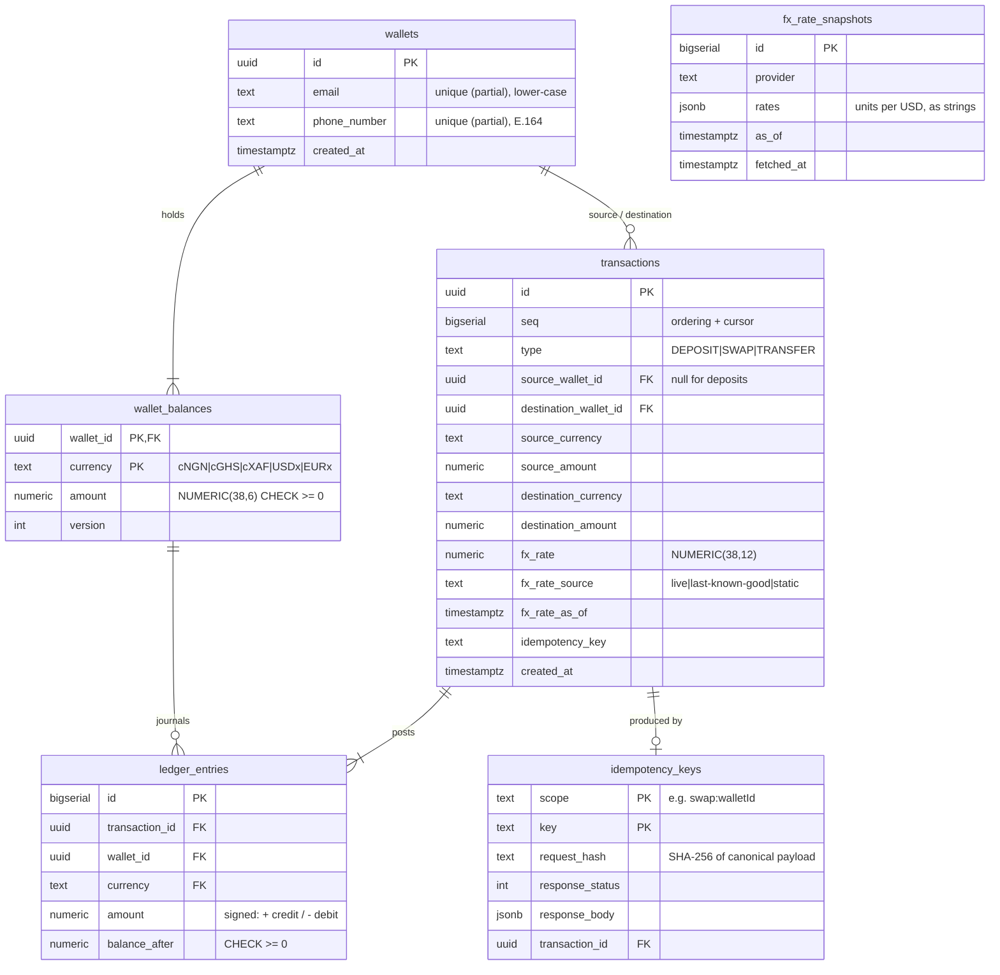

# Harmattan 🌬️

> The Harmattan is the West African trade wind that crosses borders every year without asking anyone for permission. This API does the same for money.

**Harmattan** is the backend for a stablecoin-powered cross-border payments sandbox, built for **Operation Borderless**. It provides multi-currency wallets holding mock stablecoins (**cNGN, cGHS, cXAF, USDx, EURx**), simulated deposits, FX swaps, wallet-to-wallet transfers with automatic conversion, transaction history, and live FX rates with fallbacks.

```text
docker compose up --build     # API on :3000, Swagger UI on :3000/docs
yarn test                     # 94 unit + e2e tests against real Postgres & Redis
```

---

## Contents

1. [Tech stack](#tech-stack)
2. [Why PostgreSQL (and where Redis/BullMQ earn their place)](#why-postgresql-and-where-redisbullmq-earn-their-place)
3. [Running it](#running-it)
4. [Running the tests](#running-the-tests)
5. [API walkthrough](#api-walkthrough)
6. [Data model](#data-model)
7. [Engineering decisions](#engineering-decisions)
   - [Money precision](#money-precision)
   - [Idempotency](#idempotency)
   - [Concurrency](#concurrency)
   - [FX rates and provider failures](#fx-rates-and-provider-failures)
8. [Architecture](#architecture)
9. [Assumptions](#assumptions)
10. [Known limitations and what I would do with more time](#known-limitations-and-what-i-would-do-with-more-time)

---

## Tech stack

| Area | Choice | Notes |
| --- | --- | --- |
| Runtime | **Node.js 24 LTS** ("Krypton") | Pinned in `.nvmrc`, `engines` and the Docker image |
| Language | **TypeScript 6**, `strict: true` | Plus `noImplicitOverride`, `noImplicitReturns`, `useUnknownInCatchVariables` |
| Framework | **NestJS 12** (Express) | Modules, DI, global validation pipe and exception filter |
| Database | **PostgreSQL 18** via **TypeORM** | Hand-written migrations; schema never auto-synced |
| Cache / queue | **Redis 8** + **BullMQ** | Shared FX cache and a cluster-wide refresh job (see below) |
| Money maths | **decimal.js** | No JavaScript floats anywhere in the money path |
| Validation | class-validator / class-transformer | `whitelist` + `forbidNonWhitelisted` on every request |
| API docs | `@nestjs/swagger` | Live at `/docs`; committed spec at [`docs/openapi.json`](docs/openapi.json) |
| Tests | **Jest + Supertest + Testcontainers** | E2E tests boot real Postgres and Redis containers |
| Tooling | Yarn, ESLint (type-checked rules), Prettier, GitHub Actions CI | |
| Runtime | Docker multi-stage image, `docker compose` | Non-root user and healthchecks |

---

## Why PostgreSQL (and where Redis/BullMQ earn their place)

This is a ledger, and a ledger needs the guarantees a relational database gives:

- **ACID transactions across several rows.** A transfer debits one balance, credits another, writes a transaction, writes two journal entries and stores an idempotency record. All of that commits together or not at all.
- **Row-level pessimistic locks** (`SELECT … FOR UPDATE`) to serialise concurrent changes to the same balance.
- **Exact decimal storage** (`NUMERIC(38,6)`), so amounts are never floats, even inside the database.
- **Constraints as a last line of defence.** `CHECK (amount >= 0)` on balances, partial unique indexes for one wallet per email or phone, and per-type shape checks on transactions. Even a bug in application code cannot produce a negative balance.

MongoDB has multi-document transactions, but row locks, `CHECK` constraints and exact `NUMERIC` arithmetic are native to Postgres and central to this problem.

**Redis and BullMQ are used only where they add something Postgres doesn't:**

| Use | Why it earns its place |
| --- | --- |
| **Redis: shared FX rate cache** | With N API replicas, every instance quotes from *the same* rate table (consistent prices), and the provider is called once per TTL instead of once per instance. If Redis fails, the cache counts as a miss, never as an error. |
| **BullMQ: repeatable FX refresh job** | The scheduler is keyed in Redis, so the refresh runs **once per interval across the whole cluster**, not once per replica. Provider failures are **retried with exponential backoff**. |
| ❌ *Not* Redis for idempotency or balances | Idempotency keys must commit atomically *with* the ledger write. If they were in Redis, a crash between the two writes could move money without storing the key, or the reverse. They stay in Postgres. |

---

## Running it

### With Docker (recommended)

```bash
docker compose up --build
```

This starts **Postgres 18**, **Redis 8** and the **API**. Migrations run automatically on boot, and the API waits for healthy dependencies.

| URL | What |
| --- | --- |
| <http://localhost:3000/docs> | Swagger UI |
| <http://localhost:3000/docs/openapi.json> | Live OpenAPI document |
| <http://localhost:3000/health> | Health check (Postgres + Redis) |
| <http://localhost:3000/api/v1/...> | The API |

Ports can be overridden if they are taken: `API_PORT=3700 POSTGRES_PORT=5434 REDIS_PORT=6381 docker compose up --build`.

Useful overrides:

```bash
FX_PROVIDER=static docker compose up --build                            # fully offline, fixed rates
FX_API_URL=https://fx-provider.invalid docker compose up --build        # simulate a provider outage
```

### Locally (hot reload)

```bash
nvm use                       # Node 24
corepack enable               # Yarn
yarn install
docker compose up -d postgres redis
cp .env.example .env
yarn start:dev
```

Migrations run on boot. They can also be run manually with `yarn migration:run`, or reverted with `yarn migration:revert`.

---

## Running the tests

```bash
yarn test         # everything: unit + e2e
yarn test:unit    # fast, no Docker needed
yarn test:e2e     # API tests against real Postgres + Redis
yarn test:cov     # with coverage
```

- **Docker must be running** for the e2e suite. [Testcontainers](https://testcontainers.com/) starts throwaway `postgres:18-alpine` and `redis:8-alpine` containers, runs migrations once, and tears them down at the end. Nothing else needs to be installed or started.
- To use existing instances instead (for example CI services), set `TEST_DATABASE_URL` and `TEST_REDIS_URL`.
- E2E tests use a **fixed rate table** (`FX_PROVIDER=static`), so results are deterministic and no network access is needed.

What is covered (94 tests):

| Area | Highlights |
| --- | --- |
| Money | `0.1 + 0.2 = 0.3` exactly; strict parsing; rounding direction; currency mismatch is a bug |
| FX | Cache hit, live fetch, **last-known-good fallback**, **static fallback**, single-flight on cache misses, cross-rate maths |
| Wallets | Email or phone, normalisation, duplicates (409), **8 concurrent sign-ups → exactly one wins** |
| Deposits | Replay returns the same response with no double credit; key reuse with a different payload → 422; **10 concurrent duplicates → credited once**; 20 parallel `0.1` deposits sum to exactly `2.000000` |
| Swaps | Exact conversions and rounding; overdraft → 422 with details; **10 concurrent swaps on one balance never overdraw** |
| Transfers | Same and cross currency; **30 simultaneous opposite-direction transfers, no deadlock, no lost update** |
| History | Newest first, every filter, cursor pagination with no gaps or duplicates |
| Ledger invariant | After every scenario, *sum of journal entries = stored balance* for every currency |

---

## API walkthrough

Base URL: `http://localhost:3000/api/v1`. Full reference: [`docs/openapi.json`](docs/openapi.json) or `/docs`.

#### Conventions

- **Amounts are decimal strings** (`"150.50"`), never JSON numbers, with up to 6 decimal places. Responses always use the canonical 6-dp form (`"150.500000"`). Rates use 12 dp.
- **Every money-moving `POST` requires an `Idempotency-Key` header** (8–255 printable characters; a UUID is ideal). A retry with the same key and payload returns the original response with `Idempotent-Replayed: true`.
- **Errors** share one envelope: `{ error: { code, message, details? }, statusCode, path, timestamp, requestId }`. Every response carries an `x-request-id`.

| Method | Path | Purpose |
| --- | --- | --- |
| `POST` | `/wallets` | Create a wallet (email and/or phone) |
| `GET` | `/wallets/{walletId}` | Wallet + balances + USD total |
| `GET` | `/wallets/{walletId}/balances` | Real-time balances + USD total |
| `POST` | `/wallets/{walletId}/deposits` | Simulated deposit |
| `POST` | `/wallets/{walletId}/swaps` | Swap between stablecoins in the wallet |
| `POST` | `/wallets/{walletId}/transfers` | Send to another wallet (same or different currency) |
| `GET` | `/wallets/{walletId}/transactions` | History: newest first, filters, cursor pagination |
| `GET` | `/transactions/{transactionId}` | One transaction |
| `GET` | `/fx/rates` | All pair rates with refresh times |
| `GET` | `/health` | Liveness/readiness |

The examples below are real responses from `docker compose up` with **live** rates (IDs shortened).

### 1. Create wallets

```http
POST /api/v1/wallets
Content-Type: application/json

{ "email": "ada@example.com" }
```

```jsonc
// 201 Created
{
  "id": "42327240-f570-4c8c-bf1a-ed8b7ef92bd1",
  "email": "ada@example.com",
  "phoneNumber": null,
  "createdAt": "2026-10-29T09:19:39.673Z",
  "portfolio": {
    "walletId": "42327240-…",
    "balances": [
      { "currency": "cNGN", "amount": "0.000000", "usdValue": "0.000000" },
      { "currency": "cGHS", "amount": "0.000000", "usdValue": "0.000000" },
      { "currency": "cXAF", "amount": "0.000000", "usdValue": "0.000000" },
      { "currency": "USDx", "amount": "0.000000", "usdValue": "0.000000" },
      { "currency": "EURx", "amount": "0.000000", "usdValue": "0.000000" }
    ],
    "totalUsd": "0.00",
    "rateSource": "live",
    "ratesRefreshedAt": "2026-10-29T00:02:31.000Z"
  }
}
```

A wallet can also be created with `{ "phoneNumber": "+233201234567" }` (E.164 format). Emails are trimmed and lower-cased, so `ADA@example.com` counts as a duplicate:

```jsonc
// 409 Conflict
{
  "error": { "code": "WALLET_ALREADY_EXISTS", "message": "A wallet already exists for this email", "details": { "field": "email" } },
  "statusCode": 409, "path": "/api/v1/wallets", "timestamp": "…", "requestId": "b9fc4872-…"
}
```

### 2. Deposit

```http
POST /api/v1/wallets/42327240-…/deposits
Idempotency-Key: dep-0001-ada
Content-Type: application/json

{ "currency": "USDx", "amount": "250.00" }
```

```jsonc
// 201 Created   Idempotent-Replayed: false
{
  "id": "7a198207-7821-408b-8c6b-99c1c3e9ed37",
  "type": "DEPOSIT",
  "status": "COMPLETED",
  "sourceWalletId": null,
  "destinationWalletId": "42327240-…",
  "source": null,
  "destination": { "currency": "USDx", "amount": "250.000000" },
  "fx": null,
  "createdAt": "2026-10-29T09:19:39.808Z"
}
```

Sending the identical request again returns **the same body** with `Idempotent-Replayed: true`, and the balance is still 250. Reusing the key with a different amount returns `422 IDEMPOTENCY_KEY_REUSED`.

### 3. Swap

```http
POST /api/v1/wallets/42327240-…/swaps
Idempotency-Key: swp-0001-ada

{ "fromCurrency": "USDx", "toCurrency": "cNGN", "amount": "100" }
```

```jsonc
// 201 Created
{
  "id": "869a3105-…",
  "type": "SWAP",
  "status": "COMPLETED",
  "sourceWalletId": "42327240-…",
  "destinationWalletId": "42327240-…",
  "source":      { "currency": "USDx", "amount": "100.000000" },
  "destination": { "currency": "cNGN", "amount": "134623.688800" },
  "fx": {
    "rate": "1346.236888000000",
    "source": "live",
    "provider": "open.er-api.com",
    "refreshedAt": "2026-10-29T00:02:31.000Z"
  },
  "createdAt": "2026-10-29T09:19:39.846Z"
}
```

A swap that would overdraw is rejected, and nothing moves:

```jsonc
// 422 Unprocessable Entity
{
  "error": {
    "code": "INSUFFICIENT_FUNDS",
    "message": "Insufficient USDx balance: available 150.000000, requested 1000.000000",
    "details": { "walletId": "42327240-…", "currency": "USDx", "available": "150.000000", "requested": "1000.000000" }
  },
  "statusCode": 422, "path": "/api/v1/wallets/42327240-…/swaps", "timestamp": "…", "requestId": "…"
}
```

### 4. Transfer (with automatic conversion)

`destinationCurrency` is optional and defaults to `sourceCurrency` (a same-currency transfer).

```http
POST /api/v1/wallets/42327240-…/transfers
Idempotency-Key: trf-0001-ada

{
  "destinationWalletId": "b2102b46-8a94-4ff6-b9cf-b0039b8f63df",
  "sourceCurrency": "cNGN",
  "destinationCurrency": "cGHS",
  "amount": "50000"
}
```

```jsonc
// 201 Created
{
  "id": "a803ee06-…",
  "type": "TRANSFER",
  "status": "COMPLETED",
  "sourceWalletId": "42327240-…",          // sender
  "destinationWalletId": "b2102b46-…",     // receiver
  "source":      { "currency": "cNGN", "amount": "50000.000000" },
  "destination": { "currency": "cGHS", "amount": "432.313068" },
  "fx": { "rate": "0.008646261370", "source": "live", "provider": "open.er-api.com", "refreshedAt": "2026-10-29T00:02:31.000Z" },
  "createdAt": "2026-10-29T09:19:39.866Z"   // timestamp
}
```

### 5. Balances

```http
GET /api/v1/wallets/42327240-…/balances
```

```jsonc
// 200 OK
{
  "walletId": "42327240-…",
  "balances": [
    { "currency": "cNGN", "amount": "84623.688800", "usdValue": "62.859433" },
    { "currency": "cGHS", "amount": "0.000000",     "usdValue": "0.000000" },
    { "currency": "cXAF", "amount": "0.000000",     "usdValue": "0.000000" },
    { "currency": "USDx", "amount": "150.000000",   "usdValue": "150.000000" },
    { "currency": "EURx", "amount": "0.000000",     "usdValue": "0.000000" }
  ],
  "totalUsd": "212.86",
  "rateSource": "live",
  "ratesRefreshedAt": "2026-10-29T00:02:31.000Z"
}
```

### 6. Transaction history

Query parameters:

- `type`: `deposit`, `swap`, `transfer`, `transfer_in` or `transfer_out`
- `currency`: the currency that moved on *this* wallet's side
- `limit`: 1–100, default 20
- `cursor`: the opaque `pageInfo.nextCursor` from the previous page

```http
GET /api/v1/wallets/42327240-…/transactions?limit=2
```

```jsonc
// 200 OK
{
  "data": [
    { "id": "a803ee06-…", "type": "TRANSFER", "kind": "transfer_out", "source": { "currency": "cNGN", "amount": "50000.000000" }, "destination": { "currency": "cGHS", "amount": "432.313068" }, "fx": { "rate": "0.008646261370", "…": "…" }, "createdAt": "…" },
    { "id": "869a3105-…", "type": "SWAP",     "kind": "swap",         "…": "…" }
  ],
  "pageInfo": { "limit": 2, "hasMore": true, "nextCursor": "Mg" }
}
```

`GET /api/v1/transactions/{id}` returns a single transaction in the same shape (without `kind`).

### 7. FX rates

```http
GET /api/v1/fx/rates            # all 20 ordered pairs
GET /api/v1/fx/rates?from=cNGN  # filter by from and/or to
```

```jsonc
// 200 OK
{
  "source": "live",                          // live | last-known-good | static
  "provider": "open.er-api.com",
  "stale": false,                            // true when a fallback is being served
  "refreshedAt": "2026-10-29T00:02:31.000Z", // when the provider last updated the rates
  "fetchedAt": "2026-10-29T09:18:58.061Z",   // when Harmattan fetched them
  "rates": [
    { "from": "cNGN", "to": "cGHS", "rate": "0.008646261370", "refreshedAt": "2026-10-29T00:02:31.000Z" },
    { "from": "cNGN", "to": "cXAF", "rate": "0.437166062857", "refreshedAt": "2026-10-29T00:02:31.000Z" },
    { "from": "cNGN", "to": "USDx", "rate": "0.000742811320", "refreshedAt": "2026-10-29T00:02:31.000Z" },
    { "from": "cNGN", "to": "EURx", "rate": "0.000666461459", "refreshedAt": "2026-10-29T00:02:31.000Z" }
  ]
}
```

### Error codes

| HTTP | `error.code` | When |
| --- | --- | --- |
| 400 | `VALIDATION_ERROR` | Malformed body or query (`details` lists each problem) |
| 400 | `IDEMPOTENCY_KEY_REQUIRED` | Missing or invalid `Idempotency-Key` |
| 400 | `INVALID_CURSOR` | Tampered pagination cursor |
| 404 | `WALLET_NOT_FOUND` / `TRANSACTION_NOT_FOUND` | Unknown id |
| 409 | `WALLET_ALREADY_EXISTS` | Email or phone already has a wallet |
| 422 | `INSUFFICIENT_FUNDS` | Operation would make a balance negative |
| 422 | `IDEMPOTENCY_KEY_REUSED` | Same key, different payload |
| 422 | `SAME_CURRENCY_SWAP` / `SELF_TRANSFER` / `AMOUNT_TOO_SMALL` | Business-rule violations |

---

## Data model



- **`wallet_balances`**: one row per wallet and currency, created when the wallet is created. This is the hot row that gets locked.
- **`transactions`**: one immutable row per business event. `CHECK` constraints enforce each type's shape: a deposit has no source, a swap is within one wallet between different currencies and must carry a rate, and a transfer is between two different wallets.
- **`ledger_entries`**: an append-only journal with signed movements and `balance_after`. Reconciliation invariant: `SUM(amount)` per (wallet, currency) = `wallet_balances.amount`. The test suite checks this after each money-moving scenario.
- **`idempotency_keys`**: the stored response for each (scope, key) pair.
- **`fx_rate_snapshots`**: every successful provider fetch. It doubles as the fallback source and an audit trail of the rates used.

---

## Engineering decisions

### Money precision

- **No floats.** On the wire, amounts are **strings** validated by a strict pattern (no exponents, no leading zeros, at most 6 dp, greater than 0, at most 1 trillion per operation). A JSON number such as `10` is rejected.
- **In code**, every amount is a `Money` value object (`src/common/money/money.ts`) wrapping **decimal.js** with 60 significant digits. Arithmetic between different currencies throws, because it is a bug, not a conversion.
- **In the database**, amounts are `NUMERIC(38,6)` and rates are `NUMERIC(38,12)`. The pg driver returns them as strings, so they never pass through a JS `number`.
- **Rounding policy:**
  1. The cross rate `from→to = (to per USD) / (from per USD)` is rounded **half-even to 12 dp**.
  2. The converted amount is `amount × rate`, rounded **down** to 6 dp. The platform never credits more value than it debited; the sub-micro-unit remainder stays with the house.
  3. The **rounded rate is the one applied and the one stored**, so every conversion can be reproduced exactly from the transaction row.
  4. If a conversion would round to zero, it is rejected with `AMOUNT_TOO_SMALL` rather than silently swallowing funds.
- `totalUsd` is informational and rounded half-even to cents. Per-balance `usdValue` keeps 6 dp.

### Idempotency

Every money-moving `POST` takes an `Idempotency-Key`. Keys are scoped per operation and wallet (for example `swap:<walletId>`).

1. **Claim the key in the same database transaction as the money movement.** The `INSERT INTO idempotency_keys` is the first statement of the transaction that also locks balances and writes the ledger. Both commit or roll back together, so "money moved but key not stored" (or the reverse) cannot happen, even if the process crashes.
2. **Concurrent duplicates** block on the key's primary key until the first request finishes. If the first commits, the duplicate gets a unique violation and **replays the stored response**. If the first rolls back, the duplicate proceeds as the new first attempt. Tested with 10 simultaneous identical deposits: credited once, one ID, nine replays.
3. **Payload fingerprint.** A SHA-256 of the canonicalised request (route parameters and body, key-order independent) is stored with the key. Reusing a key with a different payload returns `422 IDEMPOTENCY_KEY_REUSED`.
4. **Failures are not stored.** If a swap fails with `INSUFFICIENT_FUNDS`, everything rolls back, including the key. The client can top up and **retry with the same key**.
5. Replays return the original status code and body plus `Idempotent-Replayed: true`.

### Concurrency

The `LedgerService` (`src/ledger/ledger.service.ts`) is the **only code that changes balances**. Each posting:

1. Runs inside the request's database transaction (READ COMMITTED).
2. Locks every affected balance row with `SELECT … FOR UPDATE`, **always ordered by `(wallet_id, currency)`**. Postgres takes the row locks in that sorted order, so two transfers in opposite directions (A→B and B→A) request their locks in the same order and **cannot deadlock**. Tested with 30 simultaneous opposite-direction transfers.
3. **Re-checks funds against the locked values.** After waiting for a lock it sees the latest committed balance, so the classic "check, then someone else spends, then debit" race cannot overdraw. Tested with 10 concurrent swaps and transfers on one balance: exactly the affordable number succeed.
4. Writes the transaction, the new balances (incrementing `version`) and one journal entry per leg.

Backstops: `CHECK (amount >= 0)` on balances and `CHECK (balance_after >= 0)` on the journal. Wallet uniqueness relies on partial unique indexes rather than a "check then insert" (tested with 8 concurrent sign-ups).

**No network I/O happens while row locks are held.** FX quotes are fetched *before* the database transaction opens.

### FX rates and provider failures

Rates come from **[open.er-api.com](https://open.er-api.com)** (free, no API key), quoted against USD. Each stablecoin is pegged 1:1 to its fiat currency (cNGN→NGN, cGHS→GHS, cXAF→XAF, USDx→USD, EURx→EUR), and cross rates are derived through USD.

Rates resolve through a **chain of responsibility**:

```text
Redis cache (TTL 5 min) → live provider (3s timeout) → last-known-good snapshot (Postgres) → static table
```

- **Live success:** the response is validated as untrusted input (shape, base, every required code positive and finite), persisted to `fx_rate_snapshots`, cached in Redis and served with `source: "live"`.
- **Provider down** (timeout, 5xx, bad payload): the latest persisted snapshot is served with `source: "last-known-good", stale: true` and cached for only 30 seconds, so the provider is retried soon. Verified against the real stack by pointing `FX_API_URL` at an unreachable host.
- **Never had a successful fetch:** a fixed reference table is served with `source: "static", stale: true`. XAF is derived from its legal euro peg, so cXAF/EURx stays consistent.
- **Every quote and every transaction records** the rate, its source, the provider and its refresh time. A swap executed on stale rates is visible in the data.
- **Background refresh:** a BullMQ job scheduler refreshes rates every 5 minutes, once across the cluster, retrying failures 3 times with exponential backoff.
- **Stampede protection:** concurrent cache misses inside one process share a single provider call (single-flight).
- `FX_PROVIDER=static` makes the whole system deterministic and offline (used by the tests).

---

## Architecture

```text
src/
├── main.ts / app.setup.ts       # bootstrap; global pipes, filter, helmet, request-id (shared with tests)
├── config/                      # env schema validated at boot + typed AppConfigService
├── common/
│   ├── money/                   # Money value object, Currency catalogue, @IsPositiveAmount
│   ├── errors/                  # DomainError hierarchy (code + HTTP status)
│   ├── filters/                 # single error envelope
│   └── middleware/              # x-request-id propagation
├── database/                    # TypeORM options + hand-written migrations
├── redis/  queue/               # ioredis client, BullMQ root
├── fx/                          # providers (Strategy), rate service (Chain of Responsibility),
│                                #   Redis cache, BullMQ refresh job, GET /fx/rates
├── wallets/                     # wallet creation, balances, USD valuation
├── ledger/                      # transactions + journal entities, LedgerService (sole balance writer)
├── idempotency/                 # exactly-once executor + Idempotency-Key decorator
├── payments/                    # use cases: deposits, swaps, transfers (one service each)
└── transactions/                # read side: history + lookup
```

Design choices:

- **Thin controllers, one service per use case** (`DepositsService`, `SwapsService`, `TransfersService`).
- **Single writer for balances.** Every money movement goes through `LedgerService.post()`, which uses a unit of work (`EntityManager`) passed in by the idempotency executor.
- **Strategy pattern** for FX providers, selected once at the composition root by `FX_PROVIDER`.
- **Domain errors** carry a stable machine-readable `code` and are mapped to HTTP status in one global filter, so domain code never imports HTTP concepts.
- **Response DTOs** decouple the API from ORM entities, and **config is validated at boot**, so the app refuses to start with bad configuration.
- **Tests run against the real stack:** the same `AppModule` and `configureApp()` as production, with real Postgres and Redis.

---

## Assumptions

- **No authentication**, as the brief says. Anyone with a wallet ID can operate on it. In production the wallet would come from the authenticated principal, not the URL.
- **Deposits mint stablecoins.** There is no on-ramp, reserve or treasury account, so deposits are single-entry credits. Swaps trade against implicit house liquidity at the mid-market rate with **no fees or spread**.
- **Stablecoins are pegged 1:1 to their fiat**, so mid-market fiat FX is the stablecoin FX.
- **Six decimal places** for every stablecoin (the common on-chain precision for USDC and similar tokens).
- **One wallet per email and per phone number.** A wallet may have both; each must be unique. Phone numbers must be E.164.
- **Transfers are addressed by wallet ID.** The sender chooses the receiving currency (it defaults to the sending currency).
- **Rates are executed, not quoted.** A swap uses the rate at execution time. There is no quote-then-confirm step.
- **Per-operation cap** of 1,000,000,000,000 units, to keep inputs sane.

## Known limitations and what I would do with more time

| Left out | Why / what I'd do |
| --- | --- |
| Authentication and authorisation | Out of scope per the brief. Next step: API keys or JWT, wallet ownership checks, per-wallet rate limiting (`@nestjs/throttler` backed by Redis). |
| Quote-and-lock FX | Add `POST /fx/quotes` returning a short-lived, server-signed quote ID, so a client can see the exact rate and execute against it (with slippage protection), instead of execution-time rates. |
| Fees and spread | Add a configurable spread per pair, posted to a revenue account. |
| Full double-entry with system accounts | Model a treasury/liquidity wallet per currency so *every* posting balances to zero across accounts, including deposits and swaps. The journal and the `LedgerService` interface were designed with this in mind. |
| Withdrawals, reversals, statuses | Only `COMPLETED` exists today. I'd add `PENDING`/`FAILED`/`REVERSED` with compensating entries, plus withdrawals. |
| Idempotency key expiry | Keys are kept forever. I'd add a TTL (for example 24–72 h) with a scheduled cleanup job. |
| Outbox and webhooks | A transactional outbox table plus a BullMQ worker to publish `transaction.completed` events and notify users reliably. |
| Hot-wallet contention | Row locks serialise per balance, which is correct but caps throughput for a single very hot wallet. At scale I'd look at sharded sub-balances or batched postings. |
| Stale-rate policy | Swaps are allowed on `last-known-good` rates and the staleness is recorded. With more time I'd add a maximum-age policy (for example, reject swaps if rates are older than N minutes) and a second live provider before falling back to snapshots. |
| Observability | Structured JSON logs (pino) with request IDs, Prometheus metrics (posting latency, lock wait, FX source mix), OpenTelemetry tracing, Bull Board for the queue. |
| Recipient lookup | Send by email or phone (resolving to a wallet ID), with a confirmation step showing the recipient. |
| Postman collection | The OpenAPI spec can be imported straight into Postman or Insomnia. |

---

<sub>Built for the Cardtonic Operation Borderless assessment.</sub>
